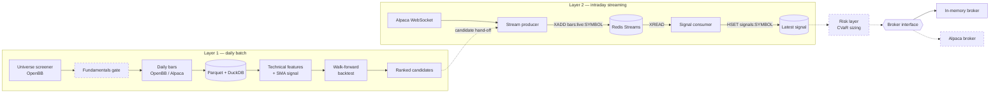

# Market Streaming Platform [In Progress]

A Python platform for market data ingestion, signal research, and order execution — batch and streaming pipelines feeding a signal layer, with risk controls and a broker abstraction in front of execution.

## Architecture (local)

This is the local setup. A cloud deployment (AWS) may swap components — e.g. S3 + Athena in place of Parquet + DuckDB — while keeping the same interfaces.

The system runs at two frequencies with different jobs:

- **Layer 1 — daily batch (population filtering).** Screen a broad equity universe, drop financially unhealthy names, and walk-forward backtest daily technical signals to find tickers where a signal has a persistent out-of-sample edge. Output: a ranked candidate list.
- **Layer 2 — intraday streaming (execution timing).** For the candidates, stream live bars and generate intraday signals to time entries and exits.

A risk layer sits between them, sizing positions before orders reach the broker.



Solid boxes and arrows are built; dashed ones are in progress or planned.

### Streaming data flow

1. **Producer** ([`ingestion/streaming.py`](src/msp/ingestion/streaming.py)) — receives one bar per symbol per minute from the Alpaca WebSocket and publishes `symbol, timestamp, close, volume, vwap` to a Redis Stream keyed `bars:live:<symbol>`. It does no processing: its only job is to get raw bars into the transport as fast as possible.
2. **Consumer** ([`consumer/redis_consumer.py`](src/msp/consumer/redis_consumer.py)) — reads each stream with a blocking `XREAD`, computes signals from each bar, and writes the latest signal per symbol to a Redis hash `signals:<symbol>`.
3. Both processes share a shutdown pattern — a `threading.Event` stop flag checked each iteration — so a runner script can stop them cleanly from a signal handler.

## Design decisions

**Broker behind an interface.** [`execution/broker.py`](src/msp/execution/broker.py) defines an abstract `Broker` (`submit_order`, `get_positions`, `get_account`, …) with `Order`, `Position` and `AccountInfo` value objects. Everything else calls the interface, never a concrete broker, so backtest, paper and live trading differ by one line of configuration — and adding a second broker (e.g. Interactive Brokers) means writing one class.

**Storage behind an interface.** [`storage/storage.py`](src/msp/storage/storage.py) defines `PriceStorage`; [`ParquetPriceStorage`](src/msp/storage/parquet_storage.py) implements it with Parquet on disk and DuckDB as the query engine. Writes are idempotent (re-writing the same bars doesn't duplicate them), and `get_latest_date` supports incremental loads. A cloud store can replace it without touching callers.

**Transport is not storage.** The message bus (Redis Streams) carries events between processes; Parquet/DuckDB holds batch results. The daily job writes candidates to storage and *announces* them on the bus — the streaming side never reads the database directly, so swapping either one leaves the other untouched.

**Research mechanics, not baked-in decisions.** Modules provide mechanisms; thresholds come from experiments. SMA windows are found by a grid search on training data and judged out-of-sample; fundamental screening rules are passed in as data rather than hard-coded.

**Validated configuration.** [`config/settings.py`](src/msp/config/settings.py) uses pydantic-settings to load and validate every credential and tunable at startup, so a missing API key fails immediately rather than mid-run.

**Testable without the network.** Network-facing classes accept injected clients — the streaming producer and consumer are unit-tested against `fakeredis` — and data transformations are pure DataFrame-in, DataFrame-out functions.

## What's here

| Module | Contents | Status |
|---|---|---|
| [`ingestion/universe.py`](src/msp/ingestion/universe.py) | Equity universe via OpenBB screener and discovery endpoints | Built |
| [`ingestion/historical.py`](src/msp/ingestion/historical.py) | Loaders for equities, intraday bars (Alpaca, paginated), macro, FX, fixed income, fundamentals, commodities, news | Built |
| [`ingestion/fundamentals.py`](src/msp/ingestion/fundamentals.py) | Fundamentals fetch, unit normalisation, rule-based screening | In progress |
| [`ingestion/streaming.py`](src/msp/ingestion/streaming.py) | Alpaca WebSocket → Redis Streams producers (crypto and equities) | Built |
| [`storage/`](src/msp/storage/) | `PriceStorage` interface, Parquet + DuckDB implementation | Built |
| [`features/technical.py`](src/msp/features/technical.py) | SMA, EMA, RSI, MACD, Bollinger Bands, ATR, OBV, z-score | Built |
| [`signals/signals.py`](src/msp/signals/signals.py) | SMA crossover signal | Built |
| [`backtesting/`](src/msp/backtesting/) | `Backtester` interface, `MACrossBacktester` with grid-search optimisation, walk-forward runner over a universe | Built |
| [`consumer/redis_consumer.py`](src/msp/consumer/redis_consumer.py) | Streaming signal consumer | Built |
| [`execution/`](src/msp/execution/) | `Broker` interface, in-memory broker | Built (Alpaca broker planned) |
| [`config/settings.py`](src/msp/config/settings.py) | Centralised, validated settings | Built |

## Setup

Requires Python 3.12+, [uv](https://docs.astral.sh/uv/) and Docker.

```bash
uv sync --dev
cp .env.example .env  # fill in ALPACA_API_KEY, ALPACA_SECRET_KEY, ALPACA_BASE_URL, FRED_API_KEY
```

Alpaca paper-trading keys are free; settings validation fails at import if any key is missing.

## Running the streaming pipeline locally

Crypto trades around the clock, so BTC/USD works at any time. Bars arrive about once a minute.

```bash
# Redis (once)
docker build -t msp-redis docker/redis/
docker run -d --name redis-dev -p 6379:6379 msp-redis

# terminal 1 — producer
uv run python -c "
from msp.ingestion.streaming import CryptoStreamProducer
CryptoStreamProducer(['BTC/USD', 'ETH/USD']).start()
"

# terminal 2 — consumer
uv run python -c "
from msp.consumer.redis_consumer import RedisConsumer
RedisConsumer(['BTC/USD', 'ETH/USD']).run()
"

# terminal 3 — watch the latest signal
docker exec -it redis-dev redis-cli HGETALL "signals:BTC/USD"
```

## Running tests

```bash
uv run pytest -m "not integration"   # unit tests only: no credentials or network
make test-int                        # integration tests (hit external APIs, need credentials)
make test-all                        # everything
```

Unit tests replace Redis with `fakeredis` and run in a few seconds.

## Roadmap

1. Fundamental screening — quality gate before backtesting
2. Daily candidate pipeline wiring universe → fundamentals → backtest → storage → hand-off
3. Risk layer — CVaR optimisation and position sizing with Riskfolio-Lib
4. Alpaca broker implementation, then paper trading end to end
5. Strategy-agnostic backtest runner

## Stack

- [OpenBB](https://openbb.co/) — market data routing (equities, macro, fundamentals, FX)
- [Alpaca](https://alpaca.markets/) — intraday bars and real-time WebSocket streaming; brokerage (planned)
- [Redis Streams](https://redis.io/docs/latest/develop/data-types/streams/) — streaming transport
- [DuckDB](https://duckdb.org/) + Parquet — local analytical storage
- [pandas](https://pandas.pydata.org/) / [pandas-ta](https://github.com/twopirllc/pandas-ta) — data wrangling and technical indicators
- [pydantic-settings](https://docs.pydantic.dev/latest/concepts/pydantic_settings/) — configuration
- [pytest](https://docs.pytest.org/) + [fakeredis](https://github.com/cunla/fakeredis-py) — testing
- [Riskfolio-Lib](https://riskfolio-lib.readthedocs.io/) — portfolio optimisation (planned)
